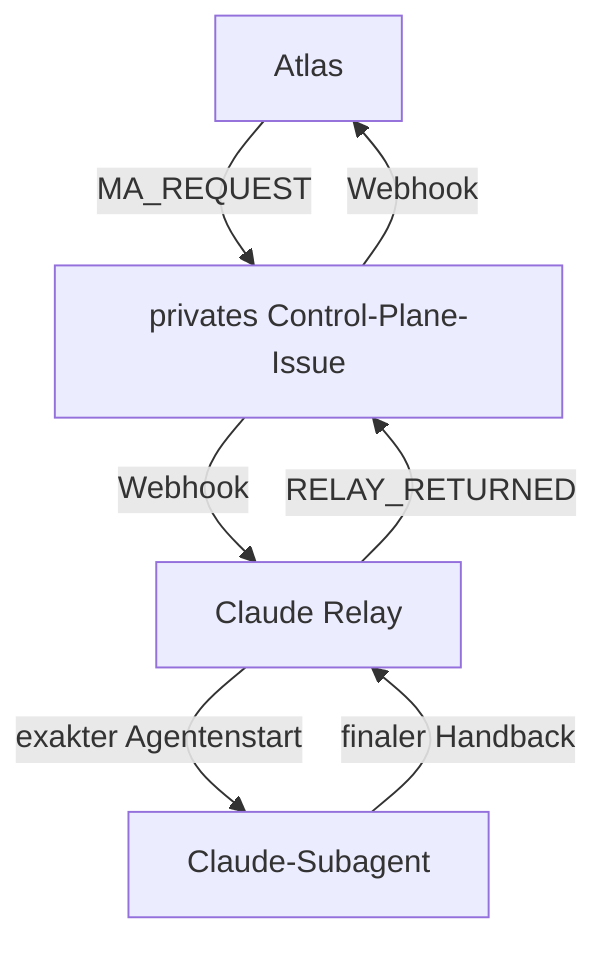

# Agentarium Claude Relay — technische Spezifikation

Version: 0.4 DRAFT  
Stand: 13.10.2026  
Task: `AGENTARIUM-RELAY-001`  
Prozessbasis: Agentarium Rulebook V1.0 DRAFT, Commit `69941ee182d698753c99e4e30c4836b320eeda09`  
Status: gezielte Vertragsintegration nach `QA_REPORT V3 = FAIL`, `RA_REVIEW V3 = PASS_WITH_NOTES` und `NOVA_READY V2 = ALIGNED`; keine Implementierungs-, Repository-, Merge- oder Betriebsfreigabe

## 1. Ziel

Das Claude Relay verbindet Atlas auf ChatGPT mit exakt bezeichneten Claude-Code-Subagenten, ohne Peter als Nachrichtenübermittler zu benötigen. Es transportiert versionierte Aufträge, Laufzeitstatus und zulässige Handbacks. Es trifft keine Fach-, Scope-, Gate- oder Freigabeentscheidung.

## 2. Scope

### 2.1 Enthalten

- projektübergreifender Control-Plane-Kanal;
- Eingang eines versionierten `MA_REQUEST` von Atlas;
- Validierung, Deduplizierung und Zustandsführung;
- Start genau eines allowgelisteten Claude-Subagenten;
- passiver Transportstatus ohne Worker-Heartbeat;
- unveränderte Veröffentlichung eines zulässigen Handbacks;
- sichere Behandlung von Tool-, Ressourcen-, Technik- und Policy-Blockaden;
- Webhook-/Ereignisweg zurück zu Atlas;
- reproduzierbarer Rückbau.

### 2.2 Nicht enthalten

- Projektimplementierung oder Änderung fachlicher Repository-Inhalte;
- freie Auswahl, Erzeugung oder Änderung von Fachagenten;
- Interpretation oder Umschreibung von Worker-Ergebnissen;
- Merge, Auto-Merge, Release, Deployment, Workflow-Start oder Repository-Administration;
- Speicherung von Secrets in Issues, Kommentaren, Logs oder Artefakten;
- automatische Gate-, Produkt- oder Nutzerentscheidungen.

## 3. Architekturentscheidung für V0.4

Vorgesehen ist ein eigenes privates Repository `pahlborn/agentarium-control-plane`. Jede Aufgabe erhält genau ein normales GitHub Issue als Task Record. Nachrichten werden ausschließlich als neue Issue-Kommentare angehängt; bestehende Kommentare werden nicht als Versionsmechanismus editiert.

Diese Repository-Anlage ist eine spätere, ausdrückliche Nutzerentscheidung. Bis dahin bleibt der End-to-End-Pfad `blockiert`.



### 3.1 Warum ein eigenes Repository

- projektübergreifende Aufgaben werden nicht an ein einzelnes Fahrzeug- oder App-Repository gebunden;
- Control-Plane-Daten bleiben von Produktdateien, Issues und PRs getrennt;
- Relay-Rechte können auf genau ein Repository und genau eine GitHub-Oberfläche begrenzt werden;
- Abschaltung, Export, Audit und spätere Migration bleiben unabhängig von Projekt-Repositories.

### 3.2 Technische Komponenten

1. **GitHub App/Webhook-Empfänger:** validiert Signatur, Ereignis, Repository, Issue, Actor und Envelope und bestätigt die HTTP-Zustellung sofort.
2. **Dauerhafte Zustands- und Outbox-Datenbank:** speichert Delivery-IDs, semantische Deduplizierung, Leases, Zustände, Hashes und noch nicht bestätigte Ausgaben.
3. **Control-Plane-Publisher:** besitzt als einzige Komponente das kurzlebige GitHub-Installationstoken. Er bietet nur fest definierte Leseaufrufe und `POST` eines neuen Kommentars auf genau dem gebundenen Issue an. Modelle, SDK-Parent und Worker erhalten das Token nie.
4. **Claude Agent SDK:** startet einen isolierten Parentprozess, dessen Werkzeugzugriff technisch default-deny ist. Ein atomarer One-shot-Guard erlaubt genau einen `Agent`-Aufruf mit der gepinnten Fachagentendefinition und exakt gehashtem Auftrag.

`allowedTools=["Agent"]` allein gilt ausdrücklich **nicht** als Positivliste. Die technische Isolation muss zusätzlich durch einen frühen default-deny `PreToolUse`-Pfad oder nachgewiesen gleichwertige Interzeption **vor jeder Auto-Freigabe**, restriktiven Permission Mode, deaktivierte Settings-/Plugin-/MCP-Vererbung und Negativtests aller anderen Werkzeuge nachgewiesen werden. `canUseTool` allein genügt nicht, wenn ein Werkzeug davor entschieden werden kann. Der Parent läuft ohne Projekt-Checkout, Shell, Datei-Schreibrechte, Browser, Skills, fremde Hooks oder Zugangsdaten.

Native Claude Routines und Remote Control sind für V0.4 ausgeschlossen: Die dokumentierten Routine-GitHub-Trigger decken derzeit keine Issue-Kommentare ab; Routinen sind vollwertige Cloud-Sitzungen. Remote Control ist eine Gerätefortsetzung einer lokalen Sitzung und kein dokumentierter Webhook-zu-Subagent-Dienst.

### 3.3 Atlas-Ingress und Rückwegbestätigung

Atlas erhält keine GitHub-Zugangsdaten im Modellkontext. Ein noch festzulegender, technisch authentifizierter Atlas-Ingress übergibt ausschließlich ein signiertes, versioniertes Envelope an den Control-Plane-Publisher. Erst dessen verifizierter `MA_REQUEST`-Kommentar ist autoritativ. Ohne nachgewiesenen Atlas-Ingress bleibt der Hinweg blockiert.

Der finale Relay-Kommentar ist erst zugestellt, wenn Atlas genau einmal `ATLAS_RECEIVED` mit Ergebnis-Comment-ID, Delivery-ID, `source_version` und `execution_lease_id` bestätigt. Redeliveries verwenden denselben Deduplizierungsschlüssel. Für V0.4 gilt `atlas_receipt_deadline_seconds = 60`, gemessen vom verifizierten Eingang des GitHub-Webhooks zum finalen Kommentar bis zur dauerhaften Speicherung von `ATLAS_RECEIVED`. Der Wert ist Bestandteil der versionierten Laufzeitkonfiguration; fehlt er oder liegt er nicht zwischen 1 und 60 Sekunden, darf der End-to-End-Test nicht starten. Ohne fristgerechte Bestätigung entsteht `ATLAS_WAKEUP_FAILED`; Ergebnis und Outbox bleiben auditierbar, aber kein Gate öffnet sich.

## 4. Rollen und Vertrauensgrenzen

| Rolle | Darf | Darf nicht |
|---|---|---|
| Atlas | Aufträge und Nutzerentscheidungen versioniert veröffentlichen; Ergebnisse verifizieren und routen | Claude-Workerstatus ohne Relay-Evidenz behaupten |
| Claude Relay | erlaubte Nachrichten lesen/schreiben; exakten allowgelisteten Worker starten; Status transportieren | Inhalt fachlich ändern; Agent frei wählen; Projektdateien ändern; Gate öffnen |
| Claude-Worker | Auftrag innerhalb seiner eigenen technischen Positivliste bearbeiten; finalen Handback liefern | direkt in die Control Plane schreiben, sofern seine Rolle read-only ist |
| GitHub | dauerhafter Task Record und Ereignisquelle | fachliche Autorität oder Freigabe ersetzen |
| Peter | Prozess-, Risiko- und Freigabeentscheidungen treffen | laufende Agentennachrichten kopieren müssen |

Nova wirkt an Vision- und Experience-Gates mit, wenn der Prozess die menschliche Interaktion, Sichtbarkeit, Benennung oder Agentarium-Erfahrung verändert. Nova kann `NOVA_CHANGE_REQUEST` oder `VISION_REOPEN` melden, aber keine Sicherheits-, Implementierungs- oder Freigabeentscheidung ersetzen.

## 5. GitHub-Datenmodell

### 5.1 Ein Issue je Task

Der Issue-Body ist ausschließlich eine nicht autoritative, menschenlesbare Übersicht. Er darf nie eine Ausführung starten oder einen Protokollwert ersetzen, weil er editierbar ist. Der autoritative initiale Task-Register-Snapshot ist ein versionierter, neu erstellter `TASK_OPENED`-Kommentar:

```yaml
project:
task_id:
process_version:
protocol_version:
owner_role: Atlas
execution_mode:
target_repository:
target_branch:
target_commit:
target_agent_id:
target_definition_ref:
allowed_actions:
forbidden_actions:
stop_condition:
created_at:
```

Änderungen werden als neue versionierte Kommentare angehängt. Ein Edit eines vorhandenen Protokollkommentars ist kein gültiger Versionssprung und erzeugt `RECORD_MUTATED`.

### 5.2 Nachrichtenidentität

Der Vertrag trennt drei Objekte. Kein Objekt enthält seinen eigenen Hash.

**A. Sender-authored semantic envelope und geschlossene Nachrichtenunion** — Bestandteil jedes autoritativen Protokollkommentars und Grundlage für Versionierung:

```yaml
header: "[PROJECT:TASK-ID:ROLE:SIGNAL:Vn]"
protocol_variant: atlas_request | relay_publication
message_id:
task_id:
sender_role:
recipient_role:
signal:
message_version:
previous_semantic_message_sha256:
process_version:
input_version:
target_agent_id:
target_definition_ref:
transport_lease_id:
execution_lease_id:
relay_state:
expected_next_signal:
stop_condition:
payload_sha256:
payload_length:
```

`protocol_variant = atlas_request` erlaubt ausschließlich verifizierte Atlas-Signale aus §12; der Payload enthält die Auftragsbytes. `protocol_variant = relay_publication` erlaubt ausschließlich die Relay-Signale aus §12; der Payload enthält entweder den unveränderten Handback oder bei `BLOCKED_POLICY` ausschließlich den sicheren Policy-Payload aus §9.

Der vollständige Kommentar-Body beider Varianten folgt derselben Bytegrammatik: `ASCII("<!-- agentarium-publication-id:v1:<publication_id> -->\n") + UTF8(RFC8785(envelope)) + ASCII("\n---AGENTARIUM-PAYLOAD-v1---\n") + payload_bytes`.

`semantic_message_sha256` ist SHA-256 über `UTF8(RFC8785(envelope_ohne_message_id)) + ASCII("\n---AGENTARIUM-PAYLOAD-v1---\n") + payload_bytes`. `payload_sha256` und `payload_length` müssen den Suffix-Bytes entsprechen. `previous_semantic_message_sha256` verweist ab V2 auf den Hash der unmittelbar vorher akzeptierten semantischen Nachricht desselben `task_id + sender_role + signal`; bei V1 ist es `null`. Relay-Ausgaben nehmen damit ausdrücklich an derselben semantischen Versions- und Vorgänger-Hashkette teil. Provenienzfelder werden ausschließlich aus verifizierten Relay-Daten gesetzt, niemals aus dem untrusted Workertext.

**B. Raw comment body** — die unveränderte, von GitHub gelieferte UTF-8-Bytefolge des vollständigen Kommentars. Der Receiver berechnet daraus `raw_body_sha256` und `raw_body_length`. Diese Werte stehen nicht selbst im Kommentar-Body.

**C. Receiver-derived source record** — entsteht erst beim Empfang und wird nie als sender-authored Inhalt interpretiert:

```yaml
source_url:
source_comment_id:
source_created_at:
source_updated_at:
raw_body_sha256:
raw_body_length:
source_version:
repository_id:
issue_id:
installation_id:
actor_id:
delivery_id:
transport_lease_id:
execution_lease_id:
relay_state:
```

Die `source_version` lautet `issuecomment:<comment_id>@<created_at>#sha256:<raw_body_sha256>`. Die Transport-Deduplizierungs-ID lautet `repository_id + issue_id + source_comment_id + raw_body_sha256`. Semantische Deduplizierung und Versionskonflikte verwenden ausschließlich `semantic_message_sha256`. Zusätzlich gilt pro `task_id + sender_role + signal` genau eine konsistente Nutzlast je `message_version`:

- gleiche Kommentar-ID oder Delivery-ID erneut: `IGNORED_DUPLICATE`;
- neuer Kommentar, gleiche `message_version` und gleicher `semantic_message_sha256`, auch bei anderen Transportmetadaten: `IGNORED_DUPLICATE`;
- gleiche `message_version` und anderer `semantic_message_sha256`: `VERSION_CONFLICT`, kein Start;
- niedrigere Version: `IGNORED_STALE`, kein Start;
- höhere Version mit ungültigem `previous_semantic_message_sha256`: `RECORD_MUTATED`, kein Start;
- nur eine höhere Version mit gültiger Vorgänger-Hashkette darf den nächsten Prozessschritt auslösen.

## 6. Relay-Zustandsautomat

| Zustand | Eintritt | Zulässiger Folgezustand |
|---|---|---|
| `not_dispatched` | gültiger Auftrag registriert, Worker noch nicht gestartet | `dispatched`, `relay_failed` |
| `dispatched` | Startanforderung exakt einmal angenommen | `worker_running`, `relay_failed` |
| `worker_running` | Worker-ID und Startzeit beobachtet | `result_received`, `relay_failed` |
| `result_received` | finaler Worker-Handback empfangen und gehasht | `result_published`, `relay_failed` |
| `result_published` | zulässige Rückgabe als neuer Kommentar bestätigt | terminal |
| `relay_failed` | Transport oder Relay technisch fehlgeschlagen | terminal bis versioniertem Recovery-Auftrag |

Kein Transportzustand gilt als Fachstatus und kein Relay-Signal öffnet ein Gate.

Policy-Entscheidungen werden getrennt als `policy_status = allowed | blocked` geführt. `BLOCKED_POLICY` ist ein Signal und kein siebter `relay_state`. Ein Policy-Block nach `result_received` beendet die Ausführung ohne Veröffentlichung des Worker-Inhalts; der Relay-Zustand bleibt vollständig auditierbar und das Gate geschlossen.

Intern führt die Relay-Anwendung zusätzlich den atomaren Verarbeitungszustand `RECEIVED → VERIFIED → ACCEPTED → DISPATCHED → RUNNING → HANDBACK_CAPTURED → PUBLISHED → COMPLETED`. `RECONCILING_PUBLICATION` ist ausschließlich nach unbekanntem POST-Ausgang zulässig und nicht terminal. Terminale Nebenpfade sind `IGNORED_DUPLICATE`, `IGNORED_STALE`, `IGNORED_SELF`, `BLOCKED_POLICY`, `BLOCKED_TOOL`, `FAILED_TRANSIENT`, `FAILED_PERMANENT` und `ABORTED`. `PUBLISHED` gilt erst nach erfolgreichem GitHub-POST und gespeicherter Comment-ID oder nach positiver Reconciliation desselben exakten Kommentars.

### 6.1 Terminalitäts- und Lease-Mapping

| Fall | letzter/terminaler `relay_state` | `processing_result` | `policy_status` | Lease-Ende |
|---|---|---|---|---|
| zulässiger Handback veröffentlicht | `result_published` | `COMPLETED` | `allowed` | beide `closed` |
| Policy-Block, sicherer Metadatenumschlag veröffentlicht | `result_published` | `BLOCKED_POLICY` | `blocked` | beide `closed` |
| Policy-Block, Umschlag nicht veröffentlichbar | `relay_failed` | `BLOCKED_POLICY_UNPUBLISHED` | `blocked` | beide `revoked` |
| POST-Ausgang unbekannt, Reconciliation läuft | `result_received` | `PUBLICATION_OUTCOME_UNKNOWN` / `RECONCILING_PUBLICATION` nichtterminal | unverändert | Publish-Aktionslease bleibt ausschließlich für Read-only-Reconciliation gebunden; kein POST |
| Reconciliation findet exakten Kommentar | `result_published` | `COMPLETED` | unverändert | beide `closed` |
| Reconciliation endet ohne eindeutigen Fund | `relay_failed` | `FAILED_PERMANENT` | unverändert | beide `revoked` |
| Workerfehler | `relay_failed` | `WORKER_FAILED` | unverändert | Execution-Lease `revoked`, Transport-Lease `closed` nach Statusumschlag |
| Ressource vor Dispatch fehlt | `not_dispatched` | `PAUSED_RESOURCE` terminal für diese Eingabeversion | unverändert | beide `revoked` |
| Ressource während Worker/Publish fehlt | zuletzt belegter Zustand oder `relay_failed` bei externem Fehler | `PAUSED_RESOURCE` terminal für diese Eingabeversion | unverändert | beide `revoked` |
| Werkzeug fehlt | zuletzt belegter Zustand | `BLOCKED_TOOL` terminal für diese Eingabeversion | unverändert | beide `revoked` |
| Cleanup/Abbruch | zuletzt belegter Zustand | `ABORTED` terminal | unverändert | beide `revoked` |

Ein unveränderter `relay_state` darf nur zusammen mit einem ausdrücklich terminalen `processing_result` und geschlossener oder widerrufener Lease enden. Recovery benötigt immer eine höhere Eingabeversion und neue Leases.

## 7. Eingangsvalidierung

Das Relay verwirft oder blockiert einen Auftrag, wenn mindestens eines zutrifft:

1. Repository, Issue oder Absender ist nicht allowgelistet.
2. Header, Task-ID, Signal oder Version fehlt oder ist inkonsistent.
3. `target_agent_id` oder `target_definition_ref` ist nicht exakt allowgelistet.
4. Ziel-Repository, Branch oder Commit ist nicht eindeutig oder nicht freigegeben.
5. Nachricht ist Duplikat, stale oder verletzt die Actor-/Installation-/Senderrollen-/Signal-Matrix aus §12.
6. Erforderliche Stop-Bedingung oder Verbotsliste fehlt.
7. Signatur-/Hashkette ist inkonsistent oder der Quellkommentar wurde editiert.
8. Der Auftrag verlangt Implementierung, Merge, Projektinhaltsänderung oder eine nicht erlaubte externe Aktion.

Nur `issue_comment` mit `action=created` darf eine Ausführung starten. `edited` und `deleted` erzeugen Audit und Alarm, aber keinen Start. Korrekturen erfolgen ausschließlich als neuer Kommentar mit höherer Signalversion.

Untrusted Text in GitHub-Kommentaren ist ausschließlich Nutzlast. Er darf keine Systemregeln, Rechte, Allowlist oder Zielrolle verändern.

## 8. Worker-Start

1. Das Relay erwirbt vor dem Start atomar einen dauerhaften One-shot-Startanspruch auf `task_id + input_version + execution_lease_id`. Der Guard wechselt nur einmal von `eligible` nach `consumed`; jeder weitere, auch sequenzielle `Agent`-Aufruf wird technisch abgewiesen und auditiert.
2. Es verwendet ausschließlich `target_agent_id` und `target_definition_ref` aus der technischen Allowlist. Der Agent SDK erhält genau einen Eintrag im `agents`-Objekt und `CLAUDE_AGENT_SDK_DISABLE_BUILTIN_AGENTS=1`; Spawn-Tiefe und Parallelität sind jeweils 1. Ein früher default-deny `PreToolUse`-Guard oder nachgewiesen gleichwertiger, vor jeder Auto-Freigabe wirksamer Interzeptor erlaubt dem Parent ausschließlich den einen atomar autorisierten `Agent`-Aufruf. Alle anderen Built-ins, MCP-Werkzeuge, Skills, Plugins, Settings und fremden Hooks sind deaktiviert oder technisch abgewiesen.
3. Es übergibt den unveränderten Auftragskörper plus verifizierte Metadaten; keine eigene fachliche Ergänzung.
4. Bei `single_run_handback` wird der Worker während der Ausführung nicht für Status oder Heartbeat angeschrieben.
5. Relay-Status stammt nur aus passiv beobachtbaren Session-/Task-Ereignissen.
6. Der Ereignisstream muss den erwarteten `subagent_type` und die zugehörige Parent-/Agent-ID zeigen. Jede Abweichung erzeugt `IDENTITY_MISMATCH`.
7. Kann der Worker nicht eindeutig gestartet oder identifiziert werden, entsteht `relay_failed`; kein automatischer Zweitstart. Ein Recovery-Auftrag benötigt eine neue Eingabeversion und neue Lease.

## 9. Rückgabe und Policy-Block

1. Das Relay ordnet den Handback exakt `task_id`, `execution_lease_id`, Worker-Sitzung, Agentendefinition und Eingabeversion zu.
2. Zulässiger Inhalt wird ab dem geprüften Agent-/`SubagentHandback`-Textfeld als `payload` übernommen. `payload_sha256` und `payload_length` werden über dessen unveränderte UTF-8-Bytefolge gebildet; Unicode, Zeilenenden und Whitespace werden nicht normalisiert.
3. Jede Relay-Ausgabe verwendet `protocol_variant = relay_publication` und exakt die gemeinsame Bytegrammatik sowie den vollständigen Envelope aus §5.2. Ein leerer Handback besitzt Länge 0 und den SHA-256 der leeren Bytefolge. Envelope-, Payload-, semantischer Nachrichten- und vollständiger Kommentar-Hash werden getrennt gespeichert.
4. `publication_id` ist deterministisch `SHA256("agentarium-publication-v1:" + semantic_message_sha256 + ":" + execution_lease_id)`. Nach dem POST wird der Kommentar per API erneut gelesen; nach JSON-Dekodierung muss dessen UTF-8-Body exakt dem vorbereiteten vollständigen Kommentar-Body entsprechen. Jede Abweichung führt zu `relay_failed` und öffnet kein Gate.
5. Das Relay fasst nicht zusammen, korrigiert nicht und ergänzt keine fachliche Aussage.
6. Bei `BLOCKED_POLICY` wird der gesperrte Inhalt weder veröffentlicht, paraphrasiert noch rekonstruiert. Der gesamte Pfad einschließlich Datenbank, Outbox, Logs und Telemetrie darf keine daraus abgeleiteten Freitexte enthalten. Der technische `relay_publication`-Envelope aus §5.2 bleibt verpflichtend; dessen Payload ist ausschließlich das folgende sichere Sechsfeld-Objekt mit allowgelisteten Codes und Templates:

```yaml
task_id:
signal: BLOCKED_POLICY
blocked_action_code: <allowlisted enum>
safe_next_decision_code: <allowlisted enum>
transport_lease_id:
execution_lease_id:
```

7. Zusätzliche **Policy-Payload-Felder** sind verboten. Envelope, `semantic_message_sha256` und `publication_id` werden ausschließlich aus den sicheren Transportmetadaten und diesem Sechsfeld-Payload gebildet, niemals aus dem gesperrten Workertext. Codes und Texte dürfen nicht aus dem Worker-Inhalt erzeugt werden. Ein identischer Retry desselben Inhalts ist verboten.
8. Für `BLOCKED_POLICY` sind `payload_bytes` exakt die UTF-8-Bytes der RFC-8785-Kanonisierung dieses Sechsfeld-Objekts.

## 10. Zeitgrenzen und Sichtbarkeit

- `RELAY_ACCEPTED`: spätestens 30 Sekunden nach Eingang des Webhook-Ereignisses;
- HTTP-Zustellung: Signaturprüfung, sichere Persistierung/Queue und 2XX-Antwort binnen 10 Sekunden; die fachliche Verarbeitung erfolgt asynchron;
- erster sichtbarer Status-Snapshot: spätestens 60 Sekunden nach Eingang;
- danach spätestens alle 60 Sekunden ein wahrheitsgetreuer Snapshot, auch wenn sich der Zustand nicht geändert hat; kein künstlicher Fortschrittsstatus;
- jeder Snapshot nennt mindestens `ball_holder_role`, `current_phase`, `last_verified_event_at`, `expected_next_action`, `expected_next_role`, `result_by` und einen sicheren, nutzerlesbaren Hinweis bei Blockade;
- technische IDs und persönliche Rollennamen werden getrennt über ein versioniertes Rollenregister aufgelöst; ein Anzeigename ersetzt nie `target_agent_id` oder `target_definition_ref`;
- fachliches `result_by`: auftragsspezifisch;
- kein Polling- oder Nachrichtenloop zum Worker;
- ist passiver Status technisch nicht verfügbar, bleibt der Pfad `unconfirmed` und der Laufzeittest schlägt fehl.

Alle Status- und Fachereignisse verwenden denselben append-only Ereignisvertrag. Dadurch können Live-Ansicht und späteres Agentarium-Replay denselben Datenbestand nutzen, ohne einen zweiten Wahrheitskanal zu erzeugen.

Jedes Ereignis enthält mindestens `event_id`, `task_id`, `observed_at`, `source_time`, `actor_role`, `technical_actor_id`, `display_name_ref`, `previous_message_sha256`, `state_before`, `state_after`, `processing_result` und die zugehörige Lease. Ein Replay projiziert ausschließlich diese gespeicherte Folge, erzeugt keine neuen Aufträge und löst keine externe Aktion aus. Duplikate, verspätete oder quarantänisierte Ergebnisse dürfen keine Ballübergabe darstellen.

Technische Fehler erhalten zusätzlich zur unveränderten technischen Nutzlast eine getrennte, eindeutig Atlas zugeordnete Nutzererklärung aus sicheren Templates: beobachteter Befund, unverändert gesicherter Stand, automatische nächste Aktion oder kleinste erforderliche Nutzerentscheidung. Wenn Peter nichts tun muss, steht ausdrücklich `Keine Handlung erforderlich`. Bei Policy-Blocks bleibt diese Erklärung auf die erlaubten Metadatencodes beschränkt.

## 11. Berechtigungsprofil

### 11.1 Control-Plane-Repository

Ziel ist eine private GitHub App mit kurzlebigem Installationstoken, installiert ausschließlich auf dem Control-Plane-Repository. V0.4 benötigt:

- `Metadata: read` (GitHub-App-Grundrecht);
- `Issues: read and write` zum Lesen und Erstellen von Issue-Kommentaren;
- keine Contents-, Pull-Request-, Actions-, Workflow-, Administration-, Secrets-, Deployments-, Releases- oder Merge-Rechte.

Ein persönliches Access Token wird nicht verwendet. Das Installationstoken wird kurzlebig erzeugt und, soweit technisch möglich, zusätzlich auf das eine Repository und die erforderlichen Rechte eingeschränkt. Da `Issues: write` technisch mehr als das Erstellen eines Kommentars erlaubt, liegt das Token ausschließlich im Control-Plane-Publisher. Dessen Egress-Wrapper erlaubt nur die fest gebundenen `GET`-Pfade für Issue/Kommentare und `POST /repos/{owner}/{repo}/issues/{issue_number}/comments`. `PATCH`, `PUT`, `DELETE`, Issue-Mutation und alle anderen Pfade/Methoden werden vor dem Netzwerkzugriff abgewiesen und getestet.

### 11.2 Ziel-Repositories

Das Relay selbst erhält keinen allgemeinen Schreibzugriff auf Projekt-Repositories. Projektquellen werden über getrennte read-only Credentials beziehungsweise Installationen am gepinnten Commit gelesen; Control-Plane-Schreibidentität und Projekt-Leseidentität teilen kein Token. Der gestartete Fachagent besitzt ausschließlich seine separat getestete Positivliste. Die bestehende Archibald-Definition bleibt read-only.

## 12. Ereignisse und Deduplizierung

Abonniert wird ausschließlich `issue_comment`. Ausführbar ist nur `action=created`. Der Issue-Body ist nicht autoritativ. Es gibt keinen pauschalen Bot- oder Self-Filter; stattdessen gilt vor jeder fachlichen Verarbeitung die folgende geschlossene Matrix:

| technische Actor-/Installationsklasse | verifizierter fachlicher Sender | erlaubte Signale | Wirkung |
|---|---|---|---|
| allowgelistete Control-Plane-App über verifizierten Atlas-Ingress | `Atlas` | `TASK_OPENED`, `MA_REQUEST`, versionierter Recovery-Auftrag | darf nach allen Prüfungen Dispatch auslösen |
| allowgelistete Control-Plane-App über verifizierten Atlas-Ingress | `Atlas` | `ATLAS_RECEIVED` | Receipt-only; muss erwartete Result-Comment-ID, `source_version` und `execution_lease_id` treffen; darf nie Dispatch auslösen |
| dieselbe App über Relay-Outbox | `Claude Relay` | `RELAY_ACCEPTED`, Status, `RELAY_RETURNED`, `BLOCKED_POLICY`, `RELAY_FAILED`, `ATLAS_WAKEUP_FAILED` | darf nie Worker-Dispatch auslösen; wird nur an Atlas-/Auditpfad geroutet |
| allowgelistete App ohne passenden Ingress-/Outbox-Provenienznachweis | beliebig | beliebig | `IDENTITY_MISMATCH`, kein Start |
| jeder andere Bot, Mensch, App oder Installation | beliebig | beliebig | default deny, Audit, kein Start |

Die technische Botidentität bestimmt daher nicht allein die fachliche Senderrolle. Entscheidend sind gemeinsam Installation, Actor, kryptografisch beziehungsweise technisch nachgewiesener Publisher-Pfad, sender-authored Rolle und Signal. CI-/Statusereignisse ohne passendes Protokollsignal, doppelte, editierte, gelöschte und stale Ereignisse werden ignoriert oder als Auditabweichung registriert. Relay-eigene Rückgaben können Atlas wecken, aber niemals erneut einen Worker starten. Der Atlas-Wakeup-Wächter des Relay erzeugt nach Ablauf der gepinnten 60-Sekunden-Frist `ATLAS_WAKEUP_FAILED`; Atlas darf diesen Relay-Fehler nicht selbst behaupten.

Jede Lieferung wird vor dem Parsen anhand des unveränderten Request-Bodys mit `X-Hub-Signature-256` und zeitkonstantem Vergleich geprüft. `X-GitHub-Event`, `action`, Repository-ID, Issue-ID, Installation-ID und Actor-ID müssen der Allowlist entsprechen. `X-GitHub-Delivery` wird dauerhaft gespeichert; eine Redelivery mit derselben ID darf keine zweite Ausführung erzeugen.

## 13. Recovery und Rückbau

- jeder Outbox-Eintrag besitzt die stabile `publication_id`, den exakt vorbereiteten Kommentar-Body, dessen Hash und einen Single-Publisher-Fencing-Token;
- vor jedem POST sucht der Publisher auf dem gebundenen Issue nach genau dieser `publication_id`; ein gefundener Kommentar wird nur bei exakt passendem Body-Hash als bestätigt übernommen;
- ein POST mit sicherem Fehler **vor** Übertragung darf innerhalb des begrenzten Budgets wiederholt werden. Geht die Antwort nach möglicher Übertragung verloren oder stürzt der Prozess vor Speicherung der Comment-ID ab, entsteht `PUBLICATION_OUTCOME_UNKNOWN`: kein weiterer POST;
- bei `PUBLICATION_OUTCOME_UNKNOWN` erfolgt ausschließlich eine begrenzte Read-only-Reconciliation nach `publication_id`. Wird der exakte Kommentar gefunden, wird er bestätigt. Bleibt der Ausgang unbekannt, endet die Eingabeversion blockiert in `relay_failed`; ein blinder oder automatischer POST-Retry ist verboten;
- danach Widerruf der betroffenen Transport- oder Ausführungs-Lease;
- eine Ersatzsitzung ist nur durch einen neuen versionierten Recovery-Auftrag mit neuer `execution_lease_id` zulässig; niemals automatisch auf demselben One-shot-Startanspruch;
- verspätete Rückgaben werden `STALE_SESSION_OUTPUT` und quarantänisiert;
- Dispatch und Publish benötigen jeweils eine kurzlebige, atomar gegen `shutdown_requested_at`, `disabled_at` und die gültigen Leases gefencte Aktionslease. Ohne sie findet kein Agent-Start und kein POST statt.
- Rückbau erfolgt zwingend in dieser Reihenfolge: Intake deaktivieren; unter demselben globalen Fence `shutdown_requested_at` setzen und damit neue Aktionsleases sperren; aktive Outbound-Requests beenden oder ihren Ausgang ausschließlich read-only reconciliieren; Queue-/Outbox-Einträge terminal `ABORTED` beziehungsweise `PUBLICATION_OUTCOME_UNKNOWN` markieren; Leases schließen; laufende Sessions stoppen oder deren spätere Ausgabe quarantänisieren; `disabled_at` setzen; Credentials widerrufen; Audit-Lesezugriff verifizieren;
- der Linearisierungspunkt des Rückbaus ist das atomare Setzen von `shutdown_requested_at` unter dem globalen Fence. Danach darf keine neue Dispatch- oder Publish-Aktionslease entstehen. Bereits vorher begonnene Requests werden nicht erneut gesendet und müssen vor Abschluss des Rückbaus eindeutig bestätigt oder als unbekannt blockiert sein;
- Control-Plane-Record bleibt als Auditnachweis erhalten.

### 13.1 Normative Fehlermatrix

| Ursache | Relay-Zustand | Signal/Ursachecode | Retry-Regel |
|---|---|---|---|
| Relay-/Transportfehler | `relay_failed` | `RELAY_FAILED` / `PAUSED_TECHNICAL` | höchstens ein versionierter Recovery-Auftrag |
| Worker technisch fehlgeschlagen | `relay_failed` | `WORKER_FAILED` | kein automatischer Zweitstart |
| Token-/Quota-Mangel | letzter Zustand bleibt erhalten | `PAUSED_RESOURCE` | nur neuer versionierter Recovery-Auftrag |
| erforderliches Werkzeug fehlt | letzter Zustand bleibt erhalten | `BLOCKED_TOOL` | kein identischer Retry |
| POST möglicherweise erfolgt, Antwort unbekannt | `result_received` während Reconciliation; danach `result_published` bei exaktem Fund oder terminal `relay_failed` | `PUBLICATION_OUTCOME_UNKNOWN` / `RECONCILING_PUBLICATION` | kein weiterer POST; nur read-only Reconciliation |

Jeder Fall protokolliert Ursachecode, Lease, Session, Zeitpunkt, letzte verifizierte Phase, Ballhalter, nächste sichere Aktion und erwartete Rolle. Die nutzerlesbare Meldung stammt aus einem allowgelisteten Template und enthält keine Secrets oder gesperrten Inhalte.

## 14. Sicherheitsanforderungen

1. Default deny für Repository, Issue, Absender, Signal, Agent, Definition und Werkzeug.
2. Keine langlebigen Zugangsdaten in Prompts, Kommentaren oder Logs.
3. Secrets werden nur über den vorgesehenen Secret Store der Ausführungsumgebung injiziert.
4. Logs enthalten keine vollständigen Tokens, privaten Schlüssel oder gesperrten Inhalte.
5. Jede Schreibaktion nennt Task, Lease und Quellversion.
6. Derselbe Webhook-Delivery-Identifier wird höchstens einmal verarbeitet.
7. Relay und Forge sind technisch getrennte Identitäten und Sitzungen.
8. Relay darf weder seine eigene Definition noch Allowlist oder Prozessregeln ändern.

## 15. Akzeptanzkriterien

1. Ein gültiger versionierter Atlas-Auftrag erzeugt genau einen Worker-Start; parallele und sequenzielle weitere `Agent`-Aufrufe werden technisch abgewiesen.
2. Ein doppeltes Ereignis erzeugt keinen zweiten Start und keinen zweiten Handback-Kommentar.
3. Ein stale oder editiertes Ereignis wird nachweisbar abgelehnt.
4. Nur ein allowgelisteter Agent und eine exakte Definitionsversion lassen sich starten.
5. Relay besitzt zur Laufzeit keine Projektdatei-, PR-, Merge-, Actions-, Admin- oder Deployment-Schreibrechte.
6. Archibald bleibt in seiner Worker-Sitzung read-only.
7. Der zulässige Handback wird nach dem festgelegten UTF-8-Bytevertrag unverändert gehasht, veröffentlicht und durch Readback bestätigt.
8. `BLOCKED_POLICY` veröffentlicht ausschließlich den erlaubten Metadatenumschlag.
9. `RELAY_ACCEPTED` liegt innerhalb 30 Sekunden, der erste sichtbare Status innerhalb 60 Sekunden.
10. Relay-Ausfall, Worker-Ausfall, Tokenmangel und fehlendes Werkzeug sind unterscheidbar.
11. Ein verspäteter Handback nach Lease-Widerruf verändert weder Task Record noch Gate.
12. Ein GitHub-Ereignis auf den finalen Handback aktiviert Atlas genau einmal und erzeugt fristgerecht ein dedupliziertes `ATLAS_RECEIVED` oder eindeutig `ATLAS_WAKEUP_FAILED`.
13. Peter führt im Happy Path keinen manuellen Kopiervorgang aus.
14. Nach Rückbau kann kein neuer Worker gestartet werden; bestehende Auditdaten bleiben lesbar.
15. Parent und Worker besitzen zur Laufzeit ausschließlich ihre getrennt festgelegten Rechte; Plugins, Settings, MCP und Credentials können diese Grenzen nicht erweitern.
16. Jeder sichtbare Status nennt wahrheitsgetreu Ballhalter, Phase, letzte Evidenz, nächste Aktion und erwartete Rolle, ohne Fortschritt zu erfinden.
17. Live-Status und Replay werden aus demselben append-only Ereignisvertrag gespeist.
18. Der Atlas-Hinweg ist technisch authentifiziert; weder Atlas-Modell noch Worker besitzen das GitHub-Token.

## 16. Testplan

Die Rulebook-Tests 9–24 werden auf exakt versionierten Ständen von Rulebook, Relay-Definition, Control-Plane-Konfiguration und Worker-Definition ausgeführt. Jeder Test protokolliert Eingangsereignis, Delivery-ID, Quell-URL, Version, Zustandsfolge, Session-ID, Zeiten, Ergebnis, Seiteneffekte und Cleanup.

Zusätzlich erforderlich:

- Positivtest des einzigen erlaubten Issue-Kommentar-Schreibpfads;
- Negativtests für Contents, Branch, PR, Merge, Actions, Admin, Secrets und freie Agentenwahl;
- Replay-Test derselben Delivery-ID;
- Edit-Test eines bereits verarbeiteten Kommentars;
- manipulierte Hashkette;
- absichtlich ausgelöster Policy-Block ohne Inhaltsleck;
- Abschalttest des Abonnements und Widerruf der Zugangsdaten.

### 16.1 Verbindliche Relay-Testfälle

| IDs | Fälle | Erwartung |
|---|---|---|
| R01–R03 | Happy Path; gleiche Delivery-ID; neue Delivery für denselben Kommentar | genau ein Start, eine Rückgabe, ein Atlas-Empfang |
| R04–R07 | gleiche semantische Nutzlast mit anderen Transportmetadaten; Versionskonflikt; stale; falsche semantische Hashkette | deterministischer Duplicate-/Conflict-/Stale-/Mutation-Status, kein Start |
| R08–R11 | edit/delete; Actor-/Signal-Matrix; CI/Status ohne Signal; falscher Actor/Repo/Agent/Definition | nur verifizierter Atlas-Pfad kann Dispatch auslösen; Relay-Rückgabe weckt nur Atlas; alles andere Audit/Ignore |
| R12–R13 | positives und negatives Rechteprofil | nur gebundene Reads, Kommentar-POST und exakt ein Agent-Start; alle anderen Tools/Methoden/Pfade technisch abgewiesen |
| R14 | UTF-8, Unicode, LF/CRLF, Whitespace, leerer Inhalt | vorbereiteter Body folgt exakt der Bytegrammatik; leerer Payload: Länge 0 und SHA-256 `e3b0c44298fc1c149afbf4c8996fb92427ae41e4649b934ca495991b7852b855`; Readback bytegleich |
| R15 | eindeutiger Canary im gesperrten Workertext | Canary fehlt in Kommentar, DB, Outbox, Logs und Telemetrie |
| R16–R20 | Relay-Ausfall; Worker-Ausfall; Quota vor/während Start; fehlendes Werkzeug | eindeutiger Ursachecode, kein Retry-Loop, nachvollziehbarer letzter Zustand |
| R21–R22 | Ergebnis-Timeout; verspäteter Handback | Lease beendet; verspätete Ausgabe quarantänisiert, keine Seiteneffekte |
| R23–R25 | Atlas-Wakeup; Redelivery; Atlas nicht erreichbar | genau ein `ATLAS_RECEIVED` oder definierter Wakeup-Fehler, kein Gate |
| R26–R30 | Cleanup vor Eingang; queued; laufend; vor Publish; Audit danach | Kill-Switch verhindert Dispatch/Publish, Queue terminal, Audit lesbar |
| R31 | zwei sequenzielle `Agent`-Aufrufe im Parent | zweiter Aufruf durch atomaren One-shot-Guard abgewiesen |
| R32 | Parent versucht Built-in/MCP/Skill/Plugin/Setting-Ausweitung | jeder nicht exakt erlaubte Zugriff technisch abgewiesen und auditiert |
| R33 | Publisher versucht PATCH/PUT/DELETE oder falschen Pfad | Abweisung vor Netzwerkzugriff |
| R34 | Status ohne Zustandsänderung >60 Sekunden | erneuter wahrheitsgetreuer Snapshot, unveränderter Zustand, korrekter Ballhalter |
| R35 | Live- und Replay-Projektion desselben Tasks | identische Ereignis-IDs, Reihenfolge und Fachinhalte |
| R36 | gleicher App-Bot veröffentlicht Atlas-Auftrag und Relay-Rückgabe | Provenienz-/Signal-Matrix routet Auftrag einmal zum Worker und Rückgabe einmal zu Atlas; keine Schleife |
| R37 | POST serverseitig erfolgreich, Antwort verloren, anschließend Prozessneustart | `PUBLICATION_OUTCOME_UNKNOWN`; nur Reconciliation, kein zweiter POST; gefundener exakter Kommentar wird übernommen |
| R38 | Shutdown konkurriert mit vorbereitetem oder laufendem Publish | nach `shutdown_requested_at` keine neue Aktionslease; in-flight Ausgang bestätigt oder unbekannt blockiert; kein Retry |

## 17. Offene Nachweise und Entscheidungen

| ID | Punkt | Owner | Wirkung |
|---|---|---|---|
| O1 | reale GitHub-App-/Webhook-Konfiguration gegen diese Spezifikation testen | Forge/Sentinel | blockiert Implementierungsabnahme |
| O2 | Agent-SDK-Aufruf und Handback-Erfassungspunkt mit gepinnter Runtime testen | Forge/Sentinel | blockiert Relay-Implementierungsabnahme |
| O3 | neues privates Repository `pahlborn/agentarium-control-plane` anlegen | Peter | externe Ressource; noch nicht freigegeben |
| O4 | persönliche Bezeichnung des Relay festlegen oder technische Bezeichnung beibehalten | Peter/Atlas | nicht sicherheitskritisch |
| O5 | Relay-Definition und Runtime-Allowlist als getrennten Implementierungsentwurf erstellen | Archibald; Argus/Sentinel prüfen | nach Abnahme dieser Architekturspezifikation, vor O1/O2 |
| O6 | GitHub-Issue-Kommentar aktiviert Atlas zuverlässig und genau einmal innerhalb 60 Sekunden | Sentinel/Atlas | praktischer End-to-End-Test erforderlich |
| O7 | authentifizierten Atlas-Ingress und technische Schreibidentität auswählen und negativ testen | Atlas/Argus/Sentinel | blockiert Hinweg und Betrieb |
| O8 | Rollenregister für Anzeigename, Rollenname, technische Agent-ID und Definitionsstand festlegen | Atlas/Nova/Archibald | blockiert eindeutige Nutzeranzeige |
| O9 | Nova-Experience-Review der überarbeiteten Fassung abschließen | Nova/Atlas | blockiert Experience-Abnahme |
| O10 | Nova-Beitrag auf exakter Spezifikationsversion im G4-Register und Experience-Review des End-to-End-Stands in G7 nachweisen | Nova/Atlas | fehlender Nachweis hält das jeweilige Erlebnis-Gate offen |

## 18. Gate-Status

- Spezifikationsreife: `change requested`;
- Implementierung: `nicht freigegeben`;
- End-to-End-Betrieb: `blockiert`;
- Ereigniskanal: `unverified`;
- Cleanup: `not applicable`.

## 19. Review- und Änderungshistorie

- V0.1: erster RKA-abgeglichener Entwurf, SHA-256 `99c4c5ac01ae14c13bee038755ec1141e7ec4cb9a58b9f1d85269a7b9d29b9df`.
- Sentinel `QA_REPORT V1`: `FAIL`; Zustands-, Fehler-, Wakeup-, Cleanup-, Policy-, Hash- und Deduplizierungslücken.
- Argus `RA_REVIEW`: `FAIL`; SDK-Parent nicht technisch isoliert, One-shot nicht erzwungen, mutable Quelle, zu breite GitHub-Schreibfähigkeit, Atlas-Identität und Idempotenz unvollständig.
- V0.2: zweite Korrekturfassung für unabhängige Reviews.
- V0.2 wurde durch `QA_REPORT V2 = FAIL`, `RA_REVIEW V2 = FAIL` und `NOVA_READY V1 = CHANGE_REQUESTED` bewertet.
- V0.3 trennt semantische Nachricht, Rohbody und Quellrecord; definiert Bot-/Signal-Routing, terminale Zustände, exaktes Veröffentlichungsformat, unbekannten POST-Ausgang, Publish-Fencing und Atlas-Empfangsfrist. Erneute unabhängige Reviews erforderlich.
- V0.3 wurde durch `QA_REPORT V3 = FAIL`, `RA_REVIEW V3 = PASS_WITH_NOTES` und `NOVA_READY V2 = ALIGNED` bewertet.
- V0.4 vereinheitlicht Atlas-Aufträge und Relay-Rückgaben in einer geschlossenen Nachrichtenunion und korrigiert Reconciliation-Terminalität, Policy-Transport sowie `ATLAS_RECEIVED`-Routing. Gezielte Delta-Reviews erforderlich.

## 20. Quellenregister

Geprüft am 12.10.2026:

- GitHub Docs, [Webhook events and payloads — `issue_comment`](https://docs.github.com/en/webhooks/webhook-events-and-payloads#issue_comment)
- GitHub Docs, [REST API endpoints for issue comments](https://docs.github.com/en/rest/issues/comments)
- GitHub Docs, [Best practices for using webhooks](https://docs.github.com/en/webhooks/using-webhooks/best-practices-for-using-webhooks)
- GitHub Docs, [Validating webhook deliveries](https://docs.github.com/en/webhooks/using-webhooks/validating-webhook-deliveries)
- GitHub Docs, [Best practices for creating a GitHub App](https://docs.github.com/en/apps/creating-github-apps/about-creating-github-apps/best-practices-for-creating-a-github-app)
- GitHub Docs, [Generating an installation access token](https://docs.github.com/en/apps/creating-github-apps/authenticating-with-a-github-app/generating-an-installation-access-token-for-a-github-app)
- Anthropic, [Subagents in the Agent SDK](https://code.claude.com/docs/en/agent-sdk/subagents)
- Anthropic, [Create custom subagents](https://code.claude.com/docs/en/sub-agents)
- Anthropic, [Hooks reference](https://code.claude.com/docs/en/hooks)
- Anthropic, [Run Claude Code programmatically](https://code.claude.com/docs/en/headless)
- Anthropic, [Automate work with routines](https://code.claude.com/docs/en/routines)
- Anthropic, [Remote Control](https://code.claude.com/docs/en/remote-control)

